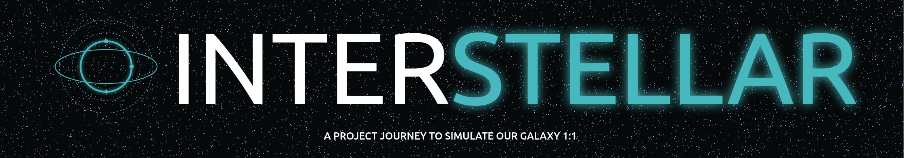
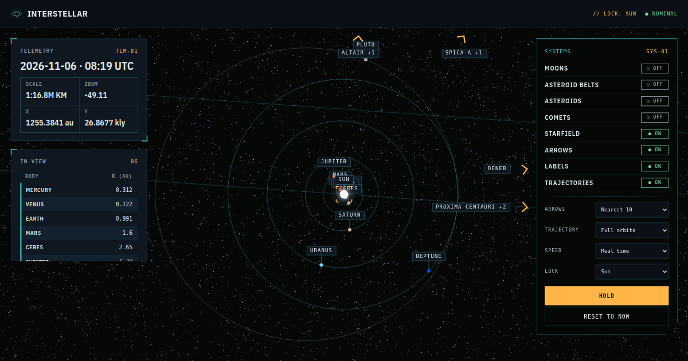

# Interstellar



[](http://commitizen.github.io/cz-cli/)
[](http://makeapullrequest.com)


[](https://github.com/phun-ky/site-interstellar/actions/workflows/deploy.yml)
[](https://www.bestpractices.dev/projects/16380)
[](https://scorecard.dev/viewer/?uri=github.com/phun-ky/site-interstellar)

## About

> A project journey to simulate our galaxy 1:1

**Live:**
[phun-ky.net/site-interstellar](https://phun-ky.net/site-interstellar/)

Interstellar is a small project I dabble with from time to time between clients.
The goal is to ultimately have a 1:1 simulation of our galaxy and to be able to
view information and follow all known celestial bodies, including calculating
trajectories of asteroids.

Today it is a 2D map of the Milky Way's centre, nearby stars and the solar
system, moving in real time or faster:

- Pan with the mouse or a finger, and zoom with the wheel or a pinch.
- Lock on any star, planet, moon, comet or asteroid to follow it, and click or
  tap a body for its details.
- Switch moons, asteroid belts, asteroids, comets, the starfield, arrows to
  off-screen bodies, labels and orbits on and off.
- Hold the simulation, change its speed, or reset it to now.
- Turn on Sound for a background ambience, and a click as each layer is switched
  on or off. It is off on every visit.

The orbital mechanics come from
[Interstellar Tools](https://phun-ky.net/interstellar-tools/).

### Timeline

- [x] **First version** is to establish a 2d space for celestial bodies and UI
- [ ] **Second version** is to convert to 3d space
- [ ] **Third version** is to use web workers in some extent
- [ ] **Fourth version** is to draw this with WebGL

See the [roadmap](ROADMAP.md) for what is planned next, and what is not.

## Table of Contents<!-- omit from toc -->

- [About](#about)
  - [Timeline](#timeline)
- [Known issues](#known-issues)
- [Development](#development)
- [Contributing](#contributing)
- [License](#license)
- [Changelog](#changelog)
- [Sponsor me](#sponsor-me)



## Known issues

- Orbits are drawn flat: inclination is ignored until the map is 3D (see the
  [timeline](#timeline)).
- [Stars in nested systems overlap at galaxy scale](https://github.com/phun-ky/site-interstellar/issues/13).
- [Labels overlap at solar system scale](https://github.com/phun-ky/site-interstellar/issues/91).
- [The body info panel can't be opened with the keyboard](https://github.com/phun-ky/site-interstellar/issues/90).

## Development

Requires Node 22.13 or later on 22, or Node 24 or later, and npm 11 or later.

```sh
npm ci
# Run the dev server on http://localhost:3000/site-interstellar/
npm run dev
# Build to dist/, then serve the build as GitHub Pages does
npm run build
npm run preview
# Lint, check formatting and typecheck
npm run lint
npm run format:check
npm run typecheck
# Fix formatting
npm run format
# Validate the built HTML (after a build)
npm run lint:html
# Unit tests, with or without the coverage floor
npm test
npm run test:coverage
# End-to-end tests (builds first)
npm run test:e2e
# Performance budgets on a throttled phone (after a build)
npm run test:performance
```

The end-to-end tests and the performance budgets use the installed Google
Chrome.

## Contributing

Want to contribute? Please read the
[CONTRIBUTING.md](https://github.com/phun-ky/site-interstellar/blob/main/CONTRIBUTING.md)
and
[CODE_OF_CONDUCT.md](https://github.com/phun-ky/site-interstellar/blob/main/CODE_OF_CONDUCT.md)

## License

This project is licensed under a
[GPL-3.0 License](https://choosealicense.com/licenses/gpl-3.0/). - see the
[LICENSE](https://github.com/phun-ky/site-interstellar/blob/main/LICENSE) file
for details.

## Changelog

See the
[CHANGELOG.md](https://github.com/phun-ky/site-interstellar/blob/main/CHANGELOG.md)
for details on the latest updates.

## Sponsor me

I'm an Open Source evangelist, creating stuff that does not exist yet to help
get rid of secondary activities and to enhance systems already in place, be it
documentation or web sites.

The sponsorship is an unique opportunity to alleviate more hours for me to
maintain my projects, create new ones and contribute to the large community
we're all part of :)

[Support me on GitHub Sponsors](https://github.com/sponsors/phun-ky).

---

p.s. **Ukraine is still under brutal Russian invasion. A lot of Ukrainian people
are hurt, without shelter and need help**. You can help in various ways, for
instance, directly helping refugees, spreading awareness, putting pressure on
your local government or companies. You can also support Ukraine by donating
e.g. to [Red Cross](https://www.icrc.org/en/donate/ukraine),
[Ukraine humanitarian organisation](https://savelife.in.ua/en/donate-en/#donate-army-card-weekly)
or
[donate Ambulances for Ukraine](https://www.gofundme.com/f/help-to-save-the-lives-of-civilians-in-a-war-zone).
